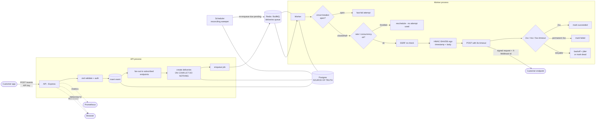

# Architecture & trade-offs (README inputs)

Drop-in material for the README (which the owner writes). The Mermaid diagram
renders on GitHub.

## System diagram

## Trade-offs digest

A condensed version of [decisions.md](./decisions.md) — the choices worth
explaining:

- **At-least-once, not exactly-once.** Across a network you cannot guarantee
  exactly-once. We guarantee at-least-once and prevent duplicates with a
  `UNIQUE(event_id, endpoint_id)` delivery row, a `jobId`-deduped queue, and a
  stable `X-Webhook-Id` header so receivers can dedupe. Trade-off: receivers must
  be idempotent.
- **Postgres is the source of truth; Redis is disposable.** The queue can be
  rebuilt from Postgres by the sweeper. Trade-off: a little duplicated state and
  a sweep interval of recovery latency, in exchange for surviving Redis loss
  (proven in the experiments).
- **BullMQ-native retries with full jitter.** Reuses battle-tested scheduling;
  jitter avoids a thundering herd when a downed receiver recovers. Trade-off: the
  processor must throw only on retryable errors and return on permanent 4xx — one
  disciplined rule.
- **Circuit breaker that still consumes an attempt when open.** Protects a down
  receiver and saves the worker the timeout wait, while still letting a
  permanently-dead endpoint march to the DLQ. Trade-off: replay of a dead
  delivery must wait out the breaker cooldown (surfaced in experiment 2b).
- **Reconciling sweeper over a transactional outbox.** Simpler, and it doubles as
  Redis-recovery. Trade-off: a lost enqueue self-heals within one sweep interval
  rather than instantly.
- **SHA-256 for API keys, HMAC for requests, SSRF checks at creation and
  delivery.** Fast exact-match for high-entropy keys; replay-protected signatures;
  DNS-rebinding defended by re-checking at POST time. Trade-off: a dev bypass
  (`SSRF_ALLOW_PRIVATE`) is needed so the in-cluster test receiver is reachable.
- **Metrics derived from Postgres at scrape time.** Correct across the API and
  worker processes without cross-process counter plumbing. Trade-off: a few COUNT
  queries per scrape.

## Measured numbers

See [BENCHMARKS.md](./BENCHMARKS.md) and [EXPERIMENTS.md](./EXPERIMENTS.md). All
numbers are dev-box, localhost, in-container receiver — a ceiling for comparison,
not a production figure.
